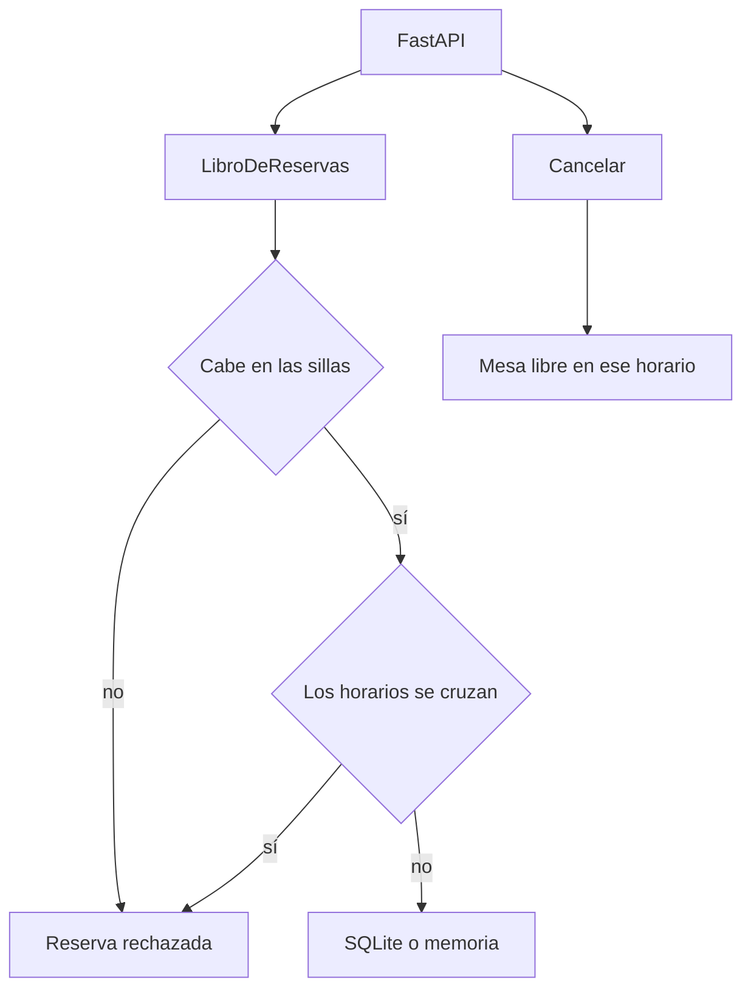

# Mesa lista

La libreta de un comedor. Una mesa tiene sillas, y dos grupos no se sientan en la misma mesa a la misma hora.

## Concepto

Abrir una mesa, reservar y cancelar. El dominio compara los intervalos: si se cruzan, la reserva no entra. Cancelar libera la mesa. FastAPI solo traduce HTTP. La memoria sirve a las pruebas de regla; SQLite guarda cuando el proceso arranca.

## Stack

| Pieza | Para qué |
| --- | --- |
| Python 3.12 | Lenguaje. |
| FastAPI | `POST /mesas` y `POST /reservas`. Puerto `3043`. |
| Arquitectura hexagonal | Los protocolos de repositorio son el puerto. |
| Clean Architecture | El dominio no importa FastAPI ni SQLite. |
| Pydantic | Cuerpos de entrada y salida. |
| SQLite | Adaptador de mesas y reservas. |
| pytest | Solape, cancelación y el API. |

## Flujo



## Correr

Desde esta carpeta:

```bash
python3 -m venv .venv
. .venv/bin/activate
pip install -r requirements.txt
pytest
PYTHONPATH=src python -m mesa.main
```
